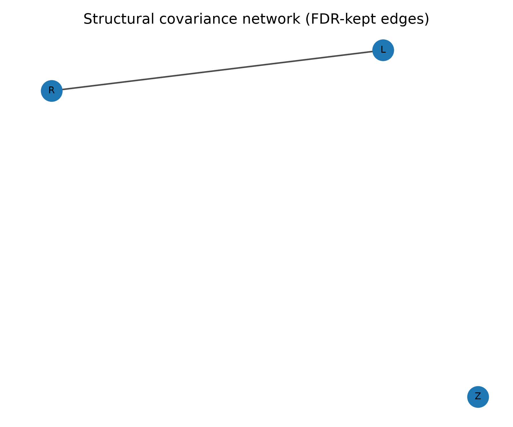

# Synthetic example: Synthetic cohort through all three analysis CLIs

Download the [repository ZIP with the example and readiness fixes](https://github.com/MPG-Git/Neurotoolbox/archive/refs/heads/codex/readiness-20261107.zip),
extract it to a writable folder, and follow the setup below. These changes are
on the review branch; downloading the older default branch may omit them.
The input files and reference outputs are already included; generation is optional.

## Run and inspect

This is a standalone Python package, not an EEGLAB plugin. From the extracted
repository folder, create/activate a Python environment and install the package:

```sh
python -m venv .venv
# Windows PowerShell: .venv/Scripts/Activate.ps1
# Linux/macOS: source .venv/bin/activate
python -m pip install .
python examples/synthetic/run_demo.py
```

The reference environment used Python 3.12; exact library versions are in
`expected/versions.json`. `requirements-tested.txt` provides the tested direct
dependency versions if you need to reproduce a version-related difference.
Install those with `python -m pip install -r examples/synthetic/requirements-tested.txt`
before installing this repository.

`data/cohort.csv` contains 80 entirely generated rows (NumPy seed 23). `age` is
in years; `gender` is a synthetic 0/1 grouping variable. L/R are positive toy
left/right ROI measurements in arbitrary units, Z is a noise ROI, and y/z are
toy behavioral scores. A shared latent variable creates a brain-behavior
association. These columns do not represent actual people or validated scales.

The runner uses the real asymmetry/normative, multivariate/network and robustness
CLIs. It saves regression/deviation tables, PLS/CCA weights and score plots,
network correlations/edges and graphics, and follow-up estimates/scatter plots.
The matching `expected/` subfolders contain actual reference CSVs and PNGs.

All columns in seven selected CSVs are compared at absolute tolerance 1e-6 plus
relative tolerance 1e-5. PLS/CCA weight vectors may flip their overall sign.
The unseeded Theil-Sen estimate is supplied for inspection but excluded from
numeric matching. `comparison.csv` lists every checked file/column. Figures
are illustrative and are not compared pixel by pixel.

Normative scores here are fitted and evaluated in the same synthetic cohort;
this is an installation example, not an externally validated normative model.
Permutation procedures assume exchangeable independent rows.



Recreate inputs with `python examples/synthetic/generate_data.py new_cohort.csv`.

## What counts as success

A successful run prints `PASS` and writes `PASS.txt` and `comparison.csv` into
the new output folder. Errors and mismatches stop the runner without a PASS file.
Open the CSV comparison and compare your plots with `expected/`.
The included reference outputs came from actual runs on November 7, 2026.

The default output is this example's `output/` directory. Existing output folders
are refused so a previous result cannot be mistaken for a fresh run.
Use `--outdir demo_run_2` for another run.

If a comparison fails, inspect the reported metric and confirm that you used
these bundled files, this repository version, and the listed dependencies.
Do not replace the reference with the failing result. `SHA256SUMS.json` records
input/reference file hashes for download-integrity checks. All input data are
generated; no participant recordings or personal data are included. The supplied
generators refuse to overwrite an existing destination.

These examples check the illustrated installation and workflow, not every menu
item or scientific validity for a particular study. Reference plots may render
differently with another operating system or graphics version.
